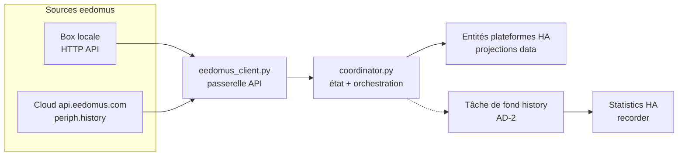
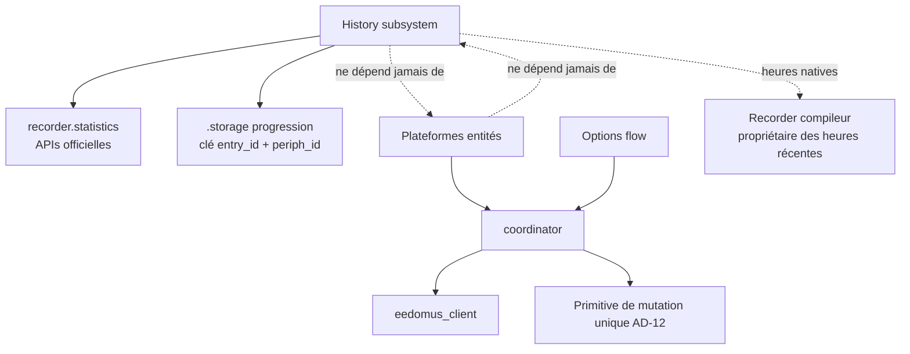
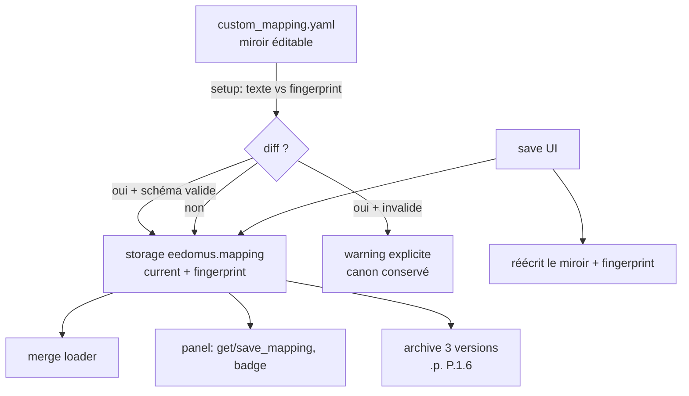

# Architecture Spine — hass-eedomus

## Design Paradigm

**Hub coordinator-centric** — le patron canonique Home Assistant pour intégrations hub, étendu d'un producteur de fond pour l'historique :

- `EedomusDataUpdateCoordinator` est le **propriétaire unique** de l'état eedomus (`coordinator.data`) et l'**orchestrateur unique** des appels API.
- Les entités de plateforme (light, switch, cover, climate, sensor, select…) sont des **projections** de `coordinator.data` — elles ne parlent jamais à l'API.
- Le sous-système history est un **producteur de fond découplé** du cycle de polling : il consomme l'API cloud à son propre rythme et écrit dans les statistics HA ; il ne participe jamais au chemin critique du temps réel.



## État actuel vs cible

**Toutes les AD-1 à AD-14 sont en vigueur dans le code** (`unstable@3dfa99e`), sauf mention contraire. Historique de conformité : AD-1 à AD-5 et AD-13/AD-14 étaient des décisions cibles à la rédaction initiale (2026-09-27/28) et sont **implémentées depuis** (worker de fond + progression `.storage`, import `async_import_statistics` uniquement, filtre AD-11 actif — commits cf8b642, 8f71efc, f2136ae, 20d3639 ; mapping en HA storage + migrations — commits fce3ba8, 5e3cad5, 051c6b4). **AD-12 reste la seule AD partiellement non appliquée** : la primitive de merge unique n'existe pas encore et `coordinator.data` a 5 writers (voir Violations connues). **AD-16 et AD-17** (décidées hors cette spine, enregistrées ici) sont en vigueur.

## Invariants & Rules

### AD-1 — Le backfill history cible les statistics horaires officielles, jamais les états bruts [ADOPTED, implémenté cf8b642/8f71efc/f2136ae]

- **Binds :** sous-système history (fetch, import), tests le couvrant
- **Prevents :** réintroduction des hacks `async_set` (entités fantômes, double-import, tempêtes recorder) ; dépendance au service Spook (payload limité 32 Ko, présence non garantie)
- **Rule :** l'import écrit exclusivement via les APIs Python officielles `async_import_statistics` (sur le `statistic_id` de l'entité réelle, dans la limite d'AD-11) du module `recorder.statistics`. Aucune écriture dans la state machine pour du passé ; aucun appel de service HTTP/websocket pour l'import. Les états bruts (panel History) ne sont pas backfillés — la timeline détaillée reste dans l'app eedomus.

### AD-2 — L'import history s'exécute dans une tâche de fond dédiée, hors du cycle de refresh [ADOPTED, implémenté 20d3639]

- **Binds :** orchestration (coordinator), cycle de vie (setup/unload/reload)
- **Prevents :** le polling temps réel (~1 s) bloqué par le backfill cloud lent (mesuré : 195 s d'history sur un cycle de 196 s) ; deux importers concurrents sur une même entry
- **Rule :** la boucle de partial refresh ne contient aucun appel `fetch/import history`. La tâche de fond est cadencée par `history_peripherals_per_scan`. Sa progression et son état de retry sont persistés dans `.storage` sous la clé **`<config_entry_id>_<periph_id>`** (multi-box safe) ; la progression d'un périph est invalidée à sa disparition ou à son remapping. À l'unload : `await` de la tâche en vol puis flush final de la progression ; au plus un importer actif par config entry (slot runtime data). **Resserrage 2026-11-01 :** la migration des anciennes progressions state-machine (`eedomus.history_progress_*`) parse les clés sans `split("_")[-1]` — parsing robuste des `config_entry_id` multi-segments, aucun bleed cross-box (`coordinator.py:1649`).

### AD-3 — Le périmètre statistics est limité aux capteurs numériques résolus [ADOPTED, implémenté]

- **Binds :** couche import, mapping
- **Prevents :** statistics hors conventions HA (sur des `light.*`/`climate.*`), population d'ids externes `eedomus:*`
- **Rule :** seuls les périphs mappés en entité `sensor` avec valeur numérique résoluble (AD-6) produisent des statistics. Le périmètre est **réévalué à chaque activation** de l'option : les progressions des périphs sortis du périmètre sont invalidées ; la documentation (AD-5) mentionne les statistics résiduelles. Les états discrets ne sont pas backfillés ; le besoin « temps d'allumage » se sert en temps réel via `history_stats` HA.

### AD-4 — Fenêtre de backfill intégrale, reprise, idempotence bornée [ADOPTED, implémenté]

- **Binds :** couche import, stockage progression
- **Prevents :** import partiel incohérent, doublons au re-import
- **Rule :** backfill de tout l'historique cloud disponible (pas d'option de fenêtre), par pagination de 10 000 points (limite documentée de l'API `periph.history`), progression par périph persistée. L'écriture statistics horaire est un upsert par heure : le re-import est sûr **à résolution de valeur constante près** — toute variation de `value_list` (AD-6bis) invalide la progression du périph.

### AD-5 — L'activation de l'option history est documentée, y compris la première fois [ADOPTED, implémenté]

- **Binds :** options flow, documentation utilisateur
- **Prevents :** activation à l'aveugle d'un backfill potentiellement long
- **Rule :** la doc de l'option décrit : ce qui se passe à l'activation (backfill intégral en tâche de fond), la durée attendue de la première activation (~90 périphs × pagination cloud, rate-limit), la reprise après redémarrage (effective uniquement une fois la progression en `.storage`, cf. AD-2), ce qui est visible dans HA (statistics/graphes long terme, pas le panel History) et ce qui ne l'est pas.

### AD-6 — Résolution de valeur : float direct, puis value_list figée, sinon exclusion [ADOPTED, resserrage implémenté coordinator.py:2211-2278]

- **Binds :** toute consommation de valeur d'historique
- **Prevents :** perte silencieuse de l'historique des périphs de type Liste (libellés `'Confort'`/`'Arrêt'`) ; réécriture silencieuse de l'historique importé
- **Rule :** `float(value)` d'abord ; en échec, lookup de la `description` dans `data[periph_id]["values"]` (API `periph.value_list` fusionnée à l'init) et retour de son `value` numérique. Non résolu → point exclu avec warning par point. **Resserrage (implémenté) :** la `value_list` de résolution est figée au fetch du chunk et persistée avec la progression ; une variation de `value_list` invalide la progression du périph.

### AD-7 — Le coordinator est l'unique point d'accès API [ADOPTED]

- **Binds :** toutes les unités consommant l'API
- **Prevents :** double source de vérité, rate-limit non coordonné
- **Rule :** aucun module hors `eedomus_client` (appelé par le coordinator) n'émet de requête eedomus.

### AD-8 — Identification : `unique_id = <config_entry_id>_<periph_id>` [ADOPTED, à resserrer]

- **Binds :** toutes les entités, résolution periph → entité
- **Prevents :** collisions entre boxes (multi-box), ids fantômes
- **Rule :** préfixe par `config_entry_id` ; l'entity registry est l'unique source de résolution periph → `entity_id`. **Resserrage cible :** l'import statistics d'un périph ne démarre qu'après résolution **exacte** dans le registry (attente de fin de setup des plateformes) ; le repli sur variante suffixée est interdit comme cible statistics, et la cible legacy `sensor.eedomus_<periph_id>` est supprimée. **Resserrage 2026-11-01 :** le worker history démarre après la fin du forward des plateformes ; `last_timestamp` n'avance qu'après résolution exacte dans le registry ; les misses de résolution ne suppriment jamais la progression persistée (frontière conservée).

### AD-9 — Résolution de config : options > data > défaut, `False` explicite honoré [ADOPTED]

- **Binds :** toute lecture d'option
- **Prevents :** options ignorées selon le chemin de persistance HA
- **Rule :** `_get_config_value(entry, key, default)` ; jamais de falsy-check (`if not value`). **Resserrage 2026-11-01 :** aucune lecture directe d'option hors `_get_config_value` — lectures directes restantes à migrer : ~10 dans `__init__.py` (:255-256, :270-276, :313-315, :406-407, :453 — lecture isolée de `entry.data`, :563-565, :583-584, :640, :755) et `coordinator.py:2168/2746`.

### AD-10 — Enveloppe de déploiement : git-only sur le RPi, validation par tests [ADOPTED]

- **Binds :** processus de livraison
- **Prevents :** dérive entre production et repo, modifications non annulables
- **Rule :** déploiement exclusivement via git (jamais scp ni édition directe sur le Pi), restart via le script de déploiement ; validation par tests unitaires (stubs HA, sans instance) et suite E2E live non destructive après chaque déploiement. Les scripts legacy à base de scp (`scripts/deploy_history_fix.sh`, `scripts/deploy_and_analyze.py`) sont à supprimer. L'écart E2E actuel (aucune couverture history/statistics) est un manque à combler à l'implémentation de AD-1.

### AD-11 — Un seul propriétaire par ligne horaire [CIBLE]

- **Binds :** couche import statistics
- **Prevents :** collision entre le backfill et le compileur statistics natif du recorder (moyennes divergentes, `sum` doublé sur l'heure de recouvrement)
- **Rule :** le backfill n'écrit que des heures **strictement antérieures à la première statistique native** du capteur (c'est-à-dire avant la première donnée recorder de l'entité) ; l'heure courante et toutes les suivantes appartiennent exclusivement au recorder. **Resserrage 2026-11-01 :** le clip vaut `min(first_native_start, début de l'heure courante)` — même sans aucune statistique native, le backfill n'écrit jamais l'heure courante ; l'import est sérialisé par rapport au compileur du recorder (pas de fenêtre TOCTOU entre la requête de frontière et l'écriture, `coordinator.py:2667-2683`).

### AD-12 — Primitive unique de mutation de `coordinator.data` [ADOPTED, à implémenter]

- **Binds :** tous les writers de `coordinator.data` — coordinator (refresh, set_value optimiste), plateformes (setup), services, commandes ws du panel
- **Prevents :** le refresh écrase la valeur optimiste d'un `set_value` et régresse le symptôme corrigé par 9abc03f
- **Rule :** toute mutation de `data` passe par une primitive unique de merge (`last_value` par horodatage, la plus récente gagne) ; la valeur optimiste survit au premier refresh postérieur au set. **Resserrage 2026-11-01 :** la primitive est obligatoire pour tout writer, sans exception — violation live constatée au gate (10 writers directs au total), voir Violations connues.



### AD-13 — Le mapping custom vit dans le HA storage ; le fichier YAML est la surface d'édition [ADOPTED, implémenté fce3ba8/5e3cad5/051c6b4]

- **Binds :** pipeline de mapping custom (merge loader, badge « modifié », `eedomus/get_mapping`/`save_mapping`) + config_manager
- **Prevents :** deux sources de vérité divergentes (fichier vs storage) tout en gardant un fichier manipulable par l'utilisateur, et le checkout git d'un déploiement git-only sali (AD-10)
- **Rule :**
  - Le canon est le HA storage (`Store eedomus.mapping`, clés `current` + `file_fingerprint`) ; **tout le runtime lit le storage uniquement** — jamais le fichier directement.
  - Le fichier `<config_dir>/eedomus/custom_mapping.yaml` est un **miroir éditable** : au setup, son **texte brut** est comparé au `file_fingerprint` ; différent → parse + validation de schéma → devient `current` (archive de la version remplacée, cap 3, la 4e purge la plus ancienne) ; YAML invalide → le canon est conservé, warning explicite ; identique → rien. Un changement de commentaire est une version (comparaison texte). **L'ingestion appartient à l'init du ConfigManager (niveau domaine, instance unique)** — jamais au setup par entry, qui s'exécuterait plusieurs fois en multi-box.
  - Le save UI écrit `current` **et** régénère le miroir + fingerprint, puis archive la version remplacée — au rechargement suivant le diff est nul : pas de double version.
  - Fichier absent ou corrompu au chargement → miroir régénéré depuis le canon (surface d'édition toujours présente). **Violations live au gate 2026-11-01 :** ingestion encore appelée par entry (`__init__.py:181`) au lieu du init domaine du ConfigManager ; le save UI réécrit le miroir sans re-lire le fichier (édition concurrente écrasée silencieusement) ; un fallback de lecture directe du fichier existe encore (`device_mapping.py:983/388`) — voir Violations connues.



### AD-14 — Montée de version : la config utilisateur est hors de l'arbre de code ; le schéma versionné migre explicitement [ADOPTED, implémenté 051c6b4]

- **Binds :** stockage `eedomus.mapping` (AD-13), fichier intégré seed, montées de version (HACS/git)
- **Prevents :** la perte silencieuse de config utilisateur à l'update (cas HACS) et des configs stockées réinterprétées sans migration après évolution du schéma
- **Rule :**
  - Canon + miroir config-dir vivent hors de l'arbre de code : un update ne peut pas les écraser ; le seed intégré ne s'applique qu'aux installations fraîches — un canon existant prime toujours sur les nouveaux défauts.
  - Le fichier intégré est un **exemple** (`custom_mapping.yaml.example`, en-tête « ne pas éditer ») : plus personne n'édite un fichier que l'update écrase.
  - `config_schema_version` dans le storage (absent = 1, version de naissance) + **chaîne ordonnée de migrations pures** (dict→dict, testables une par une), appliquées au chargement tant que la version stockée < la version courante. Une migration réussie **archive l'ancien canon comme version** (`reason: migration`, traçable dans l'Historique) et régénère miroir + fingerprint. Un échec conserve le canon + warning — jamais destructif.

### AD-16 — Deux strates E2E : live-Pi = vérité de régression, simulateur = multi-box + destructif [ADOPTED, enregistré 2026-11-01]

- **Binds :** toute la suite de tests d'intégration (`tests/e2e/`)
- **Prevents :** régression mockée (interdit), couverture mono-box seulement, actions destructives exercées sur la box réelle
- **Rule :** la strate live-Pi (`-m "e2e and not e2e_sim"`, `.env` + HA_TOKEN, jamais mockée) reste la vérité de régression ; la strate simulateur (`-m e2e_sim`, Flask en `requirements-test.txt` uniquement, jamais une dépendance de production) la **complète** — multi-box et destructif — sans jamais la remplacer. Décision : revue architecture 2026-10-06, spec-eedomus-simulator.

### AD-17 — Cache-busting du panneau : tout fichier JS servi porte `?v=<version manifest>` [ADOPTED, enregistré 2026-11-01]

- **Binds :** le graphe de modules du panel (`www/eedomus-panel.js` + `www/panel/*.js`), `panel.py`
- **Prevents :** un deploy qui change un module servi contre la copie cachée par le navigateur de ce module (SyntaxError live 0.15.4/0.15.5)
- **Rule :** `panel.py` sert chaque fichier JS du panel via `PanelEntryView` (enregistrée avant le static path) avec ses specifiers réécrits `from './x.js'` → `from './x.js?v=<version>` ; l'URL entry porte le même suffixe (story 106) ; le graphe entier est couvert car chaque fichier servi est réécrit (ticket 118, commit 0572863). Les fichiers repo gardent des specifiers simples — **forme unique autorisée : `from './x.js'`** (un test scanne tous les fichiers servis avec un pattern plus large et échoue sinon). La query d'une URL ne se propage PAS aux imports du module (RFC 3986) : ne jamais compter dessus.

## Consistency Conventions

| Concern | Convention |
| --- | --- |
| Nommage | `periph_id` (str) = clé universelle ; fichiers = plateformes HA ; entités `eedomus_*` suffixées par box |
| Données | timestamps eedomus naïfs heure locale → `dt_util.as_local` avant tout usage HA ; valeurs API = strings, résolution via AD-6 ; statistiques horaires alignées top-of-hour, tz-aware |
| Erreurs | retry queue par périph + `history_retry_delay` (persisté, cf. AD-2) ; jamais d'except silencieux ; un point non résolu = un warning contextué (valeur + periph) |
| Logging | cycles de refresh chronométrés et décomposés (`API / History / Processing / Endpoints`) — la lisibilité des temps est une exigence, pas une option |
| Config | toutes les options passent par le options flow ; lecture exclusive via AD-9 |

## Stack

| Name | Version |
| --- | --- |
| Python | runtime = celui de HA (3.14 sur HA 2026.9.3+, `REQUIRED_PYTHON_VER=(3,14,2)`) ; floor dev/CI 3.11 (workflows, .venv 3.11.15). AGENTS.md « 3.9+ » et black `py39` sont obsolètes — à aligner |
| Home Assistant | instance 2026.11 ; tag 2026.9.3 vérifié ; **compat min non déclarée dans `manifest.json` (open item)** ; schema recorder 53 vérifié aux tags 2026.3.0 et 2026.9.3 |
| API eedomus box locale | HTTP `api/get`, `api/set` |
| API eedomus cloud | `api.eedomus.com/get` — `periph.history` (10 000 pts/appel, limite documentée), `periph.value_list` |
| pytest | `requirements-test.txt` : `pytest>=7` (ce que CI installe) ; unitaires avec stubs HA, E2E live via REST |

## Structural Seed

```text
custom_components/eedomus/
  __init__.py, const.py, log.py
  eedomus_client.py      # passerelle API (box locale + cloud)
  coordinator.py         # état, cycles de refresh, worker de fond history
  entity.py              # base EedomusEntity, _get_config_value, préfixe unique_id
  device_mapping.py, mapping_rules.py, mapping_registry.py, value_resolver.py   # projection périph → entité + résolution de valeur
  light.py, switch.py, cover.py, climate.py, sensor.py, binary_sensor.py, select.py, scene.py, text_sensor.py
  history_sensor.py, endpoint_volume_sensor.py, refresh_timing_sensor.py
  config_flow.py, options_flow.py, config_manager.py   # config_manager = canon storage du mapping (AD-13/14)
  services.py, schema_service.py
  webhook.py, api_proxy.py, panel.py, panel_translations.py, ui_service.py, www/
tests/unit/              # stubs HA, aucune instance requise
tests/e2e/               # deux strates (AD-16) : live-Pi non destructive + e2e_sim
```

**Enveloppe opérationnelle** : cible de production = Raspberry Pi (HAOS 18.2) déployé git-only depuis ce repo ; le déploiement redémarre HA (downtime ~2-4 min) ; `purge_keep_days: 30` sur les states (les statistics long-terme ne sont pas purgées) ; Spook 5.5.1 est présent sur l'instance mais n'est **pas** une dépendance (AD-1).

## Violations connues (gate de validation 2026-11-01)

Divergences code-vs-spine constatées par le gate, chacune à transformer en ticket :

- **AD-12 non appliqué** — writers directs de `coordinator.data` : 4 sites coordinator (coordinator.py:463/991/1102/2888) + 6 sites plateformes (light.py:69, switch.py:46/154, cover.py:68, sensor.py:77, binary_sensor.py:89) ; la régression 9abc03f est toujours vivante (services.py:167 refresh juste après le set).
- **AD-13** — ingestion du fichier appelée par entry (`__init__.py:181`) au lieu du init domaine du ConfigManager (multi-box : double ingestion) ; save UI réécrit le miroir sans re-lire le fichier (édition concurrente écrasée) ; fallback de lecture directe du fichier encore présent (`device_mapping.py:983/388`).
- **AD-8** — worker démarré au premier refresh avant le forward des plateformes (coordinator.py:208 vs `__init__.py:366/617`) ; `last_timestamp` avance avant résolution registry ; 3 misses suppriment la progression persistée (:2406).
- **AD-11** — clip `stat.start < first_native_start` seulement si statistiques natives existent (:2667-2683) ; cas zéro-native écrit l'heure courante + fenêtre TOCTOU avant l'import.
- **AD-2** — migration legacy `split("_")[-1]` sur les clés `eedomus.history_progress_*` (:1649) : bleed cross-box.
- **AD-9** — lectures directes d'options hors `_get_config_value` : ~10 sites dans `__init__.py` (dont :453, lecture isolée de `entry.data`) et `coordinator.py:2168/2746`.
- **AD-7** — `config_flow.py:291,340` (`auth_test`) appelle l'API hors du coordinator.

## Deferred

- **Politique d'agrégation des warnings** (un par point vs résumé par chunk) — décision d'ergonomie de log, à trancher quand le volume de libellés non résolus sera connu.
- **Fusion multi-box au-delà du préfixage** (AD-8) — aucune consolidation d'état inter-box prévue.
- **Nettoyage des statistics fantômes existantes** (`sensor.eedomus_*` issues de l'ère async_set) — résidu de la migration AD-1, à purger.
- **Rôle futur de webhook / api_proxy** — vues enregistrées (`__init__.py:594-607`) ; aucune croissance prévue sans nouvelle décision.
- **Compat min HA déclarée dans `manifest.json`** (open item du gate : la cible ≥ 2026.3 n'est écrite nulle part de façon enforceable).
